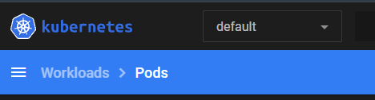
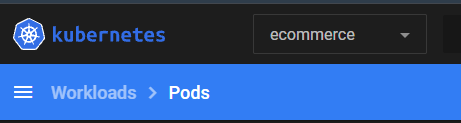

# Simple Demo Setup Guide (Minikube + Kubernetes)

Follow these steps in **PowerShell** from the project root (`final-project`) to deploy and verify the system for the demo.

---

## Prerequisites

- **Docker Desktop** is running.
- **Minikube** and **kubectl** are installed.
- **MongoDB Atlas** Network Access allows your current IP (or `0.0.0.0/0` temporarily for the demo).

---

## Step 1: Start Minikube and Enable NGINX Ingress

```powershell
minikube start
minikube addons enable ingress
kubectl wait --namespace ingress-nginx --for=condition=ready pod --selector=app.kubernetes.io/component=controller --timeout=180s
```

---

## Step 2: Build and Load Images into Minikube

Use `-p ecommerce-microservices` so image names match the Kubernetes Deployment YAML files, and tag the gateway image as `toritoru/gateway:latest`:

```powershell
docker compose -p ecommerce-microservices build
docker tag ecommerce-microservices-api-gateway:latest toritoru/gateway:latest

minikube image load `
  toritoru/gateway:latest `
  ecommerce-microservices-auth-service:latest `
  ecommerce-microservices-login-service:latest `
  ecommerce-microservices-register-service:latest `
  ecommerce-microservices-order-service:latest `
  ecommerce-microservices-product-service:latest
```

---

## Step 3: Create `kubernetes/secret.yaml` (YAML-Only Secret)

Create `kubernetes/secret.yaml` (already git-ignored) using your **MongoDB Atlas** `MONGO_URI` and `JWT_SECRET` from `.env`:

```yaml
apiVersion: v1
kind: Secret
metadata:
  name: ecommerce-secret
  namespace: ecommerce
type: Opaque
stringData:
  MONGO_URI: "mongodb+srv://<username>:<password>@<cluster-host>/<database>"
  JWT_SECRET: "your-jwt-secret"
```

---

## Step 4: Deploy All Kubernetes YAML Files

```powershell
kubectl apply -f kubernetes/namespace.yaml
kubectl apply -R -f kubernetes
kubectl wait --for=condition=available deployment --all -n ecommerce --timeout=180s
kubectl get pods,services,ingress -n ecommerce
```

Expected:
- All Pods (`gateway` ×2, `auth-service`, `login-service`, `register-service`, `order-service`, `product-service`) are `2/2` `Running`.
- All Services are `ClusterIP` (no direct external access to microservices).

---

## Step 5: Map the Ingress Domain and Start Port-Forward

1. Open **Notepad as Administrator** and add this line to `C:\Windows\System32\drivers\etc\hosts` (matches `host: ecommerce.com` in `kubernetes/nginx/ingress.yaml`):
   ```text
   127.0.0.1 ecommerce.com
   ```
   *(If you change `host` in `kubernetes/nginx/ingress.yaml` to `aupp.com`, use `127.0.0.1 aupp.com` instead and re-run `kubectl apply -f kubernetes/nginx/ingress.yaml`.)*

2. Run port-forwarding in a terminal and **keep it open**:
   ```powershell
   kubectl port-forward -n ingress-nginx svc/ingress-nginx-controller 8080:80
   ```

---

## Step 6: Verify Everything Works (Demo Checks)

Open a **second PowerShell terminal**:

1. **Test API Gateway & Ingress domain:**
   ```powershell
   Invoke-RestMethod http://ecommerce.com:8080/health
   Invoke-RestMethod http://ecommerce.com:8080/products
   ```

2. **Test MongoDB Atlas connectivity (Register & Login):**
   ```powershell
   Invoke-RestMethod -Method Post -Uri http://ecommerce.com:8080/register `
     -ContentType "application/json" `
     -Body '{"name":"Demo User","email":"demo@example.com","password":"Password123!"}'

   Invoke-RestMethod -Method Post -Uri http://ecommerce.com:8080/login `
     -ContentType "application/json" `
     -Body '{"email":"demo@example.com","password":"Password123!"}'
   ```

3. **Demonstrate Shared Kubernetes Volume (`emptyDir`) across 2 containers:**
   ```powershell
   # Container 1 (product-service) writes logs to /shared-logs/product-service.log
   kubectl exec deployment/product-service -n ecommerce -c product-service -- cat /shared-logs/product-service.log

   # Container 2 (BusyBox log-reader sidecar) reads the same file
   kubectl logs deployment/product-service -n ecommerce -c log-reader
   ```

4. **Demonstrate no direct microservice access:**
   ```powershell
   kubectl get svc -n ecommerce
   ```
   All Services are `ClusterIP` only; all external traffic must enter via `http://ecommerce.com:8080` → `gateway-service:5011`.

---

## Step 7: Testing with Postman GUI (All Microservices + Shared Volume)

> In Postman, for every `POST` and `PUT` request below: open the **Body** tab → select **raw** → choose **JSON** from the dropdown.  
> For protected routes, open the **Authorization** tab → Auth Type **Bearer Token** → paste the JWT from `/login`.

*(If you changed `host` in `kubernetes/nginx/ingress.yaml` to `aupp.com`, replace `ecommerce.com` with `aupp.com` in all URLs below.)*

### 1. API Gateway (`api-gateway`)
- **Health Check**
  - **Method & URL:** `GET http://ecommerce.com:8080/health`
  - **Auth:** None

### 2. Register Service (`register-service`) — Create Users
- **Register a Customer**
  - **Method & URL:** `POST http://ecommerce.com:8080/register`
  - **Auth:** None
  - **Body (raw JSON):**
    ```json
    {
      "name": "Alice",
      "email": "alice@example.com",
      "password": "Password123!"
    }
    ```
- **Register an Admin Candidate** *(needed to add/update/delete products and update order status)*
  - **Method & URL:** `POST http://ecommerce.com:8080/register`
  - **Body (raw JSON):**
    ```json
    {
      "name": "Admin User",
      "email": "admin@example.com",
      "password": "Password123!"
    }
    ```
  - Then open **MongoDB Atlas** → **Browse Collections** → `users` → edit `admin@example.com` and change `"role": "customer"` to `"role": "admin"`.

### 3. Login Service (`login-service`) — Get JWT Tokens
- **Login as Customer**
  - **Method & URL:** `POST http://ecommerce.com:8080/login`
  - **Auth:** None
  - **Body (raw JSON):**
    ```json
    {
      "email": "alice@example.com",
      "password": "Password123!"
    }
    ```
  - Copy the `"token"` value from the response as `<CUSTOMER_TOKEN>`.
- **Login as Admin** *(after promoting in MongoDB Atlas)*
  - **Method & URL:** `POST http://ecommerce.com:8080/login`
  - **Body (raw JSON):**
    ```json
    {
      "email": "admin@example.com",
      "password": "Password123!"
    }
    ```
  - Copy the `"token"` value from the response as `<ADMIN_TOKEN>`.

### 4. Auth Service (`auth-service`) — Verify Token & Read Profile
- **Verify Token**
  - **Method & URL:** `POST http://ecommerce.com:8080/auth/verify`
  - **Auth:** None
  - **Body (raw JSON):**
    ```json
    {
      "token": "<CUSTOMER_TOKEN>"
    }
    ```
- **Get User Profile**
  - **Method & URL:** `GET http://ecommerce.com:8080/auth/profile`
  - **Auth:** Bearer Token `<CUSTOMER_TOKEN>`

### 5. Product Service (`product-service`) — Add, Read, Update, Delete
- **Add a Product (Admin)**
  - **Method & URL:** `POST http://ecommerce.com:8080/products`
  - **Auth:** Bearer Token `<ADMIN_TOKEN>`
  - **Body (raw JSON):**
    ```json
    {
      "name": "Mechanical Keyboard",
      "description": "Wireless 75% keyboard",
      "price": 129.99,
      "quantity": 25,
      "category": "Electronics"
    }
    ```
  - Copy `product._id` from the response as `<PRODUCT_ID>`.
- **Add Multiple Products at Once (Admin, optional)**
  - **Method & URL:** `POST http://ecommerce.com:8080/products`
  - **Auth:** Bearer Token `<ADMIN_TOKEN>`
  - **Body (raw JSON):**
    ```json
    {
      "products": [
        {
          "name": "USB-C Hub",
          "price": 39.5,
          "quantity": 50,
          "category": "Accessories"
        },
        {
          "name": "Gaming Mouse",
          "price": 59.99,
          "quantity": 40,
          "category": "Accessories"
        }
      ]
    }
    ```
- **Read All Products (Public)**
  - **Method & URL:** `GET http://ecommerce.com:8080/products`
  - **Auth:** None
- **Read Single Product (Public)**
  - **Method & URL:** `GET http://ecommerce.com:8080/products/<PRODUCT_ID>`
  - **Auth:** None
- **Update Product (Admin)**
  - **Method & URL:** `PUT http://ecommerce.com:8080/products/<PRODUCT_ID>`
  - **Auth:** Bearer Token `<ADMIN_TOKEN>`
  - **Body (raw JSON):**
    ```json
    {
      "price": 119.99,
      "quantity": 20
    }
    ```

### 6. Order Service (`order-service`) — Add, Read, Update, Cancel/Delete
- **Add / Place an Order (Customer)**
  - **Method & URL:** `POST http://ecommerce.com:8080/orders`
  - **Auth:** Bearer Token `<CUSTOMER_TOKEN>`
  - **Body (raw JSON):**
    ```json
    {
      "customerName": "Alice",
      "items": [
        {
          "productId": "<PRODUCT_ID>",
          "productName": "Mechanical Keyboard",
          "quantity": 2,
          "price": 119.99
        }
      ]
    }
    ```
  - Copy `order._id` from the response as `<ORDER_ID>`.
- **Read Orders**
  - **Customer's own orders:** `GET http://ecommerce.com:8080/orders` (Bearer `<CUSTOMER_TOKEN>`)
  - **Single order:** `GET http://ecommerce.com:8080/orders/<ORDER_ID>` (Bearer `<CUSTOMER_TOKEN>`)
  - **All users' orders (Admin):** `GET http://ecommerce.com:8080/orders` (Bearer `<ADMIN_TOKEN>`)
- **Update Order Status (Admin)**
  - **Method & URL:** `PUT http://ecommerce.com:8080/orders/<ORDER_ID>`
  - **Auth:** Bearer Token `<ADMIN_TOKEN>`
  - **Body (raw JSON):** *(allowed: `pending`, `confirmed`, `shipped`, `delivered`, `cancelled`)*
    ```json
    {
      "status": "shipped"
    }
    ```
- **Cancel / Delete Order (Soft Delete)**
  - **Method & URL:** `DELETE http://ecommerce.com:8080/orders/<ORDER_ID>`
  - **Auth:** Bearer Token `<CUSTOMER_TOKEN>` (or `<ADMIN_TOKEN>`)
  - Sets order `status` to `"cancelled"` in MongoDB Atlas.

### 7. Delete Product (`product-service` — Hard Delete)
Run this after finishing the Order test above (or create another product to delete):
- **Delete Product (Admin)**
  - **Method & URL:** `DELETE http://ecommerce.com:8080/products/<PRODUCT_ID>`
  - **Auth:** Bearer Token `<ADMIN_TOKEN>`

### 8. Verify Same Shared Volume Usage After Postman Requests
Every URL you hit in Postman (`http://ecommerce.com:8080/...`) routes through `gateway` and the target microservice. Inside each Pod, Container 1 writes request logs into the shared `emptyDir` volume at `/shared-logs`, and Container 2 (`log-reader` BusyBox sidecar) reads and tails that exact same file:

```powershell
# API Gateway (wrote via http://ecommerce.com:8080/*)
kubectl exec deployment/gateway -n ecommerce -c gateway -- cat /shared-logs/gateway.log
kubectl logs deployment/gateway -n ecommerce -c log-reader

# Register Service (wrote via POST http://ecommerce.com:8080/register)
kubectl exec deployment/register-service -n ecommerce -c register-service -- cat /shared-logs/register-service.log
kubectl logs deployment/register-service -n ecommerce -c log-reader

# Login Service (wrote via POST http://ecommerce.com:8080/login)
kubectl exec deployment/login-service -n ecommerce -c login-service -- cat /shared-logs/login-service.log
kubectl logs deployment/login-service -n ecommerce -c log-reader

# Auth Service (wrote via POST http://ecommerce.com:8080/auth/verify & GET .../auth/profile)
kubectl exec deployment/auth-service -n ecommerce -c auth-service -- cat /shared-logs/auth-service.log
kubectl logs deployment/auth-service -n ecommerce -c log-reader

# Product Service (wrote via GET/POST/PUT/DELETE http://ecommerce.com:8080/products)
kubectl exec deployment/product-service -n ecommerce -c product-service -- cat /shared-logs/product-service.log
kubectl logs deployment/product-service -n ecommerce -c log-reader

# Order Service (wrote via GET/POST/PUT/DELETE http://ecommerce.com:8080/orders)
kubectl exec deployment/order-service -n ecommerce -c order-service -- cat /shared-logs/order-service.log
kubectl logs deployment/order-service -n ecommerce -c log-reader
```

---

## Step 8: Useful `kubectl` & Minikube Commands (Info, Services, URLs, Dashboard)

Use these commands during the demo to inspect cluster status, details, URLs, logs, and the Kubernetes Dashboard:

### 1. Overview of All Resources, Pods, Services & Endpoints
```powershell
# All resources in the ecommerce namespace (Pods, Services, Deployments, ReplicaSets)
kubectl get all -n ecommerce

# Detailed Pod list (node, pod IP, status)
kubectl get pods -n ecommerce -o wide

# Services, backend Pod IPs (Endpoints), and Ingress rules
kubectl get svc,endpoints,ingress -n ecommerce

# ConfigMap and Secret names
kubectl get configmap,secret -n ecommerce
```

### 2. Inspect Detailed Info (`describe` & `events`)
```powershell
# Full details of the Ingress (host, path rules, backend service:port, address)
kubectl describe ingress ecommerce-ingress -n ecommerce

# Full details of a Deployment or Service
kubectl describe deployment gateway -n ecommerce
kubectl describe svc gateway-service -n ecommerce

# Full details of a specific Pod (containers, env vars, emptyDir volume mounts, events)
# Replace <pod-name> with a Pod name from `kubectl get pods -n ecommerce`
kubectl describe pod <pod-name> -n ecommerce

# Recent cluster events in chronological order (great for troubleshooting)
kubectl get events -n ecommerce --sort-by=.lastTimestamp
```

### 3. Check Cluster Info & URLs
```powershell
# Kubernetes API server & cluster info
kubectl cluster-info

# Minikube IP and Ingress controller service
minikube ip
kubectl get svc -n ingress-nginx

# Main demo URL (while `kubectl port-forward -n ingress-nginx svc/ingress-nginx-controller 8080:80` is running)
# http://ecommerce.com:8080/health
```

### 4. View App Logs vs. Sidecar Logs
```powershell
# Main Node.js container stdout logs
kubectl logs deployment/gateway -n ecommerce -c gateway
kubectl logs deployment/auth-service -n ecommerce -c auth-service

# BusyBox sidecar logs (tailing /shared-logs/<service>.log)
kubectl logs deployment/gateway -n ecommerce -c log-reader
kubectl logs deployment/auth-service -n ecommerce -c log-reader
```

### 5. Open the Kubernetes Web Dashboard & Resource Usage
```powershell
# Launch the Minikube Kubernetes Dashboard in your browser (run in a separate terminal)
minikube dashboard

# Print only the Dashboard URL (without auto-opening a browser)
minikube dashboard --url

# Optional: enable metrics-server to view CPU & memory usage in `kubectl top` and Dashboard
minikube addons enable metrics-server
kubectl top pods -n ecommerce
```
In the dashboard, look at the navigation bar and click the dropdown:



Then, scroll and choose `ecommerce` and it will update the Pods.



In Kubernetes, **`default`** is the built-in namespace (like a default folder) where resources go whenever no `namespace` is specified.

- Your older projects (`student-service`, `app1`, `app2`, `registration-service`) were deployed without a custom namespace, so they live in **`default`**.
- This e-commerce project explicitly uses its own **`ecommerce`** namespace ([namespace.yaml](file:///c:/Users/USER/Desktop/cloudnativ/final-project/kubernetes/namespace.yaml)) to keep all of its Pods, Services, ConfigMap, Secret, and Ingress separated from other apps on Minikube.

Because the Kubernetes Dashboard starts with the namespace filter set to **`default`**, switching that dropdown to **`ecommerce`** will show your e-commerce project instead of the older `default` apps.